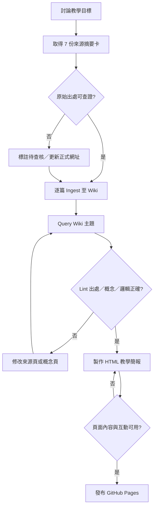

# FramePilot Wiki｜Loop／Graph 流程設計

## 哪些步驟會重複？
- 每加入一篇新來源，重新跑來源檢查、ingest 和索引更新。
- 每發現知識衝突或缺少依據，回到來源／概念頁，重新 Query 與 Lint。
- 每發現教學順序或 HTML 互動問題，修改簡報後再測試。

## 為什麼這樣設計？
優先阻擋不可靠的資料進入 Wiki，讓後面的教學內容有出處。把錯誤發現與修正集中在最接近問題來源的節點，可降低整份簡報重製成本。

## 實際修改
由於 S02 原頁無法取得、S04 舊路徑、S05 重新導向，已把「來源是否可讀與來源性質」檢查前移到 ingest 之前。

詳見 [查核紀錄](../wiki/audit.md)。